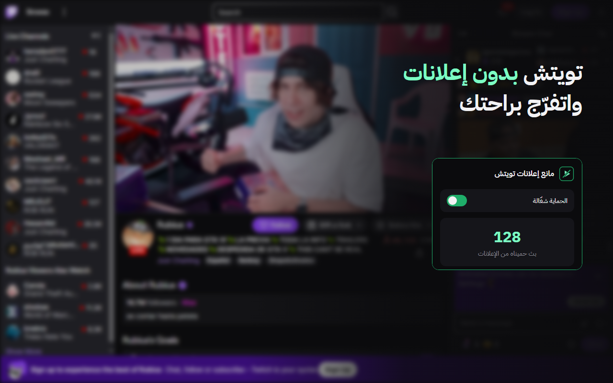

<div dir="rtl">

# مانع إعلانات تويتش

إضافة لكروم تمنع إعلانات الفيديو في twitch.tv، اللي قبل البث واللي في نصّه، عشان تتفرج براحتك.



## كيف تشتغل؟

تويتش يحط الإعلانات داخل البث نفسه، ويقرّر هذا من طلب «رمز التشغيل» اللي يرسله المشغّل: لما يكون نوعه `site` (مشغّل الموقع) أو يكون معه معرّف جهازك (Device ID). الإضافة تخلي الطلب يروح بنوع `embed` (المشغّل المضمّن) وبدون معرّف الجهاز، فيجيك البث أصلاً بدون إعلانات وبنفس الجودة. وفوق هذا تحجب سيرفرات إعلانات أمازون اللي يستخدمها تويتش.

ما تجمع أي بيانات، ولا ترسل شي لأي مكان. شوف [سياسة الخصوصية](https://ryanathlawi.github.io/twitch-adblock-ar/).

## التركيب من متجر كروم

(بنحط الرابط هنا أول ما تنقبل في المتجر)

## التركيب يدوي (خطوة بخطوة)

١. نزّل المشروع: اضغط الزر الأخضر **Code** فوق، بعدين **Download ZIP**.

٢. فك الضغط عن الملف في أي مكان تبيه.

٣. افتح كروم واكتب في شريط العنوان:
```
chrome://extensions
```

٤. شغّل **وضع المطوّر** (Developer mode) من الزاوية فوق.

٥. اضغط **تحميل إضافة غير مضغوطة** (Load unpacked)، واختر مجلد `extension` اللي داخل المشروع.

٦. افتح أي بث في twitch.tv، والإعلانات راحت 🎉

> نصيحة: ثبّت أيقونة الإضافة من زر قطعة البزل جنب شريط العنوان، عشان توصل لها بسرعة.

## النافذة

- **مفتاح التشغيل:** يشغّل الحماية أو يوقفها، وبعد ما تغيّره حدّث صفحة تويتش.
- **العدّاد:** كم بث حميناه من الإعلانات.

## التحقق بنفسك

لو عندك Node.js تقدر تشوف الفرق بنفسك:
```
node tools/check-ads.mjs without-extension
node tools/check-ads.mjs with-extension
```
السكربت يفتح كروم على أكبر القنوات المباشرة ويعدّ مقاطع الإعلانات اللي داخل البث.

## الخط

الواجهة بخط IBM Plex Sans Arabic، ورخصته مفتوحة (SIL OFL 1.1). الرخصة موجودة في `extension/fonts/OFL.txt`.

## الرخصة

MIT

</div>
